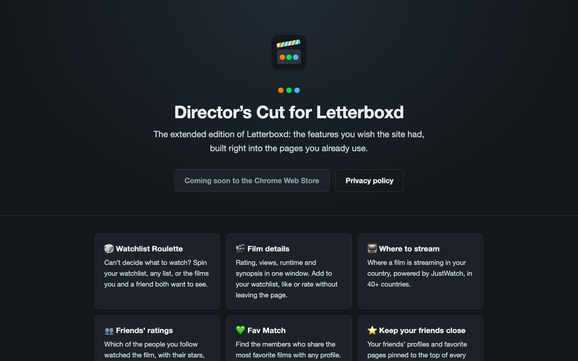

# Director's Cut for Letterboxd: home page

The public home page and privacy policy of **Director's Cut for Letterboxd**, a Chrome extension that adds watchlist
roulette, film details with streaming availability and friends' ratings, and Fav Match to Letterboxd.

- **Home page:** https://mccprogrammer.github.io/directors-cut/
- **Privacy policy:** https://mccprogrammer.github.io/directors-cut/privacy.html
- **Chrome Web Store:** https://chromewebstore.google.com/detail/kpjlaobgikkhpngdkladodopdkigmdei

The extension's own code is in a private repository; this one only holds the static pages served by GitHub Pages
(`index.html`, `privacy.html`, `icon.png`).

---

More of my work at [mccprogrammer.com/projects](https://mccprogrammer.com/projects).
